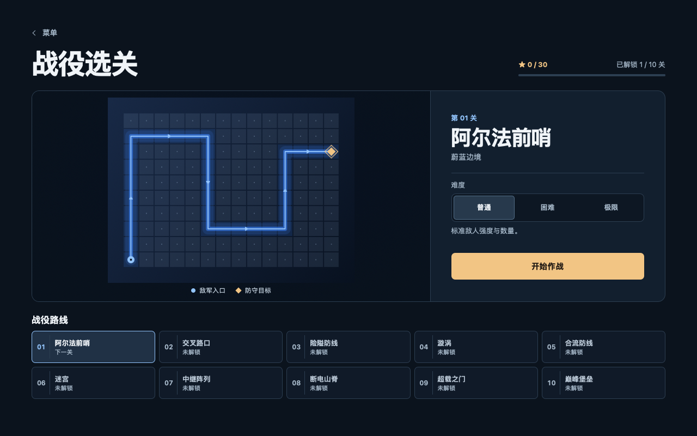

# Praesidium / 守望

守望是一款科幻塔防网页游戏。建造和升级炮塔，观察敌军路线与抗性，用陨石、冰封和修复守住防线。

**[在线游玩](https://lunora-gather.github.io/Praesidium/)** · [玩法与操作](#玩法与操作) · [本地运行](#本地运行) · [验证与部署](#验证与部署)


| 战役选关 | 战斗 |
| --- | --- |
|  |  |

[每周挑战截图](docs/media/praesidium-weekly-mode.png) · [手机横屏截图](docs/media/praesidium-mobile-landscape.png)

## 玩法与操作

| 模式 | 玩法 |
| --- | --- |
| 战役 | 十个战区、三档难度。先看地图路线和出入口，通关后解锁下一关，按剩余生命获得星级。 |
| 无尽 | 在持续增强的敌潮中刷新个人纪录。最高分和最远波次分别记录。 |
| 每日挑战 | 每天 UTC 00:00（北京时间 08:00）刷新，使用统一的当日种子和开局配置。 |
| 每周挑战 | 使用固定周种子和周规则，首次清完第 8 波可获积分。跨周续局仍按开局时的周规则结算。 |
| 挑战种子 | 可输入 P2 挑战码、兼容的 P1 旧码或最多八位的非零十六进制种子。导入局作为个人练习，活动榜与奖励单独结算。 |

六种炮塔有不同的射程、伤害和目标策略。点击已建炮塔可升级、出售或切换目标。战斗中打开简报可看下一波，暂停菜单的情报图鉴可查炮塔、敌军和抗性。关卡星级可用于升级天赋，升级效果在下次开局生效。

| 操作 | 鼠标、触屏和键盘 |
| --- | --- |
| 选塔与建造 | 点击底部炮塔，或按 `1`–`6`。聚焦棋盘后用方向键选格，再按 `Enter`。触屏小格先预览，再点同格或点「建造」。 |
| 升级、出售、目标策略 | 选中炮塔后使用面板，或按 `U`、`S`、`T`。触屏出售前会显示退款额并要求确认。 |
| 技能 | 点击技能按钮，或按 `Q`、`W`、`E`。触屏陨石需要确认落点，冰封和修复需要确认施放。 |
| 进波、暂停和倍速 | 第一波由玩家手动开始。空格暂停或继续，倍速可切换 `1×`、`2×`、`3×`。 |

设置提供自动、清晰、省电三档画质。画面震动可在 0%–150% 之间调整并预览，开启「减少动效」后暂停震动。键盘焦点用控件底部标记提示，文本输入用底色和光标表示编辑状态。

## 存档、排行榜和离线游玩

- **续局与备份** 进度保存在当前浏览器。同一对局只有一个标签页可写入，接管、替换和恢复备份前会确认。刷新后从已保存的进度暂停恢复，点「继续」恢复原倍速。在「设置 → 管理本地进度」可下载或恢复备份。
- **统计与排行榜** 可查看游玩时长、战斗成绩和炮塔使用情况。排行榜在本地生成，模拟对手会明确标注。试玩报告在「统计 → 诊断」导出，和进度备份是两个独立文件。
- **离线与更新** 首次在线打开并完成资源缓存后，可离线启动。看到更新提示时，先保存或结束对局，关闭守望的全部标签页，再从原网址重新打开。备份包含战役、天赋、纪录和当前续局。画质、语言等偏好与试玩诊断单独保存在浏览器内。

详见[本地数据与隐私说明](docs/PRIVACY.md)。

## 本地运行

使用 Node.js 24 和 npm。

```bash
git clone https://github.com/Lunora-Gather/Praesidium.git
cd Praesidium
npm ci
npm run dev
```

开发地址为 [localhost:5175](http://localhost:5175)。构建并预览生产包：

```bash
npm run build
npm run preview
```

项目使用 TypeScript、Vite、Canvas 2D 和 Web Audio。棋盘和战斗 HUD 由 Canvas 绘制。首页、选关、设置、统计和图鉴使用浏览器界面组件。IndexedDB 保存进度与续局，Service Worker 负责离线资源。

| 路径 | 内容 |
| --- | --- |
| [src/engine](src/engine) | 输入、固定时间步、相机、渲染和音频 |
| [src/game](src/game) | 战斗、炮塔、敌军、技能、地图和波次 |
| [src/ui](src/ui) | 首页、选关、战斗 HUD、简报、设置与统计 |
| [src/utils](src/utils) | 存档事务、挑战规则、计分、统计与翻译 |
| [scripts](scripts) | 浏览器回归、发布校验、平衡模拟和性能采样 |

## 验证与部署

```bash
npm run verify
npx playwright install chromium webkit
npm run verify:browser
```

| 命令 | 用途 |
| --- | --- |
| `npm run verify` | 构建和类型检查，覆盖核心玩法、存档、挑战、教程、平衡与发布资源。 |
| `npm run verify:browser` | 用 Chromium 和 WebKit 验证触控、键盘、备份、续局、离线更新和回退。 |
| `npm run balance:sim` | 模拟不同难度和建造策略。 |
| `npm run perf:browser` | 采样密集战斗帧间隔和暂停时的绘制次数。 |
| `npm run verify:pages` | 核对线上版本和资源摘要，实测开始战斗、保存与在线和离线续局。 |

推送到 `main` 后，GitHub Actions 验证生产包并发布到 GitHub Pages。版本变化见[更新记录](CHANGELOG.md)和[1.2.0 发布说明](docs/RELEASE_NOTES_v1.2.0.md)。发布流程见[发布检查表](docs/RELEASE_CHECKLIST.md)和[部署状态](docs/DEPLOYMENT_STATUS.md)。

[MIT 许可](LICENSE)
